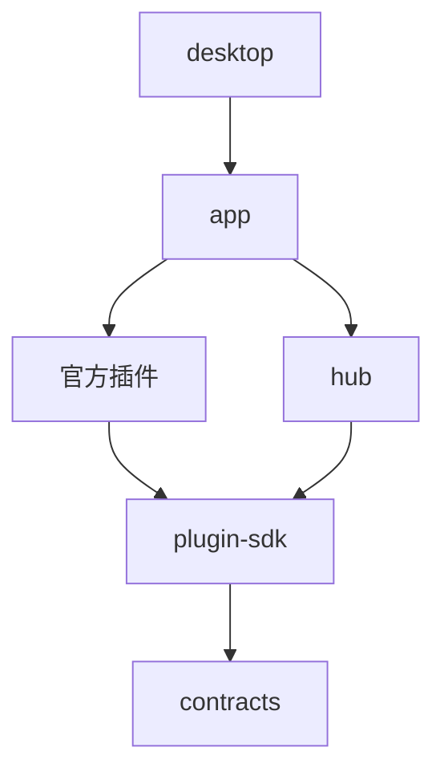

# 代码架构

打开 [交互架构图](architecture.html) 查看分层和功能模块。图上的连线表示运行时调用或事件流；跨插件调用统一经过 Hub，不代表插件直接互相依赖。

| 层 | 代码位置 | 职责 |
| --- | --- | --- |
| 桌面入口 | `crates/desktop/src/main.rs`、`updates.rs`、`installer/` | Tauri 窗口、托盘、单实例、签名更新、安装退出 |
| 应用组装 | `crates/app/src/lib.rs`、`mcp.rs` | 配置与数据目录、官方插件登记、MCP stdio 桥接 |
| 插件框架 | `crates/hub/`、`plugin-sdk/`、`contracts/`、`auth/` | 生命周期、服务路由、事件、权限、类型契约 |
| 界面与操作 | `crates/web/src/`、`templates/`、`assets/` | 信息流、筛选搜索、事件聚合、会话、设置、统一 MCP 工具与确认计划 |
| 采集 | `collect/`、`rss/`、`x-browser/`、`binance-ann/`、`okx-ann/` | 消息入库、RSS、X 浏览器采集、公告 |
| 分析 | `screen/`、`llm/`、`agent/`、`rulebook/` | 初筛、模型服务、消息分析与追问、规则 |
| 推送 | `dispatch/`、`wechat-ilink/`、`wecom-webhook/`、`ilink/` | 发送队列、重试、渠道额度与收发、微信协议 |
| 基础服务 | `store/`、`secrets/`、`scheduler/`、`maintenance/` | SQLite、加密密钥、定时任务、数据维护 |

上述简写目录均位于 `crates/`。各插件通过 `plugin-sdk` 与 `contracts` 使用服务；应用入口负责组装，Hub 负责运行。插件通过 store 服务访问各自数据表。

## MCP 与更新

外部客户端启动 `desktop.exe mcp`，通过 stdio JSON-RPC 连接本机应用；内部 AI 使用同一套工具目录和执行入口。查询直接返回；修改生成持久化计划，用户在应用确认后调用既有 GUI 业务处理器，取消、过期或重复确认不能再次执行。密钥在本机确认面板单独输入。

桌面更新从 GitHub Release 的 `latest.json` 获取版本与签名信息，自动检查、用户确认后下载安装。下载文件先校验签名，再停止核心服务并交给 NSIS。签名私钥保存在仓库外，CI 使用 GitHub Secret。

## 构建依赖示意

此依赖图只突出分层关系；具体依赖以各 crate 的 `Cargo.toml` 为准。
