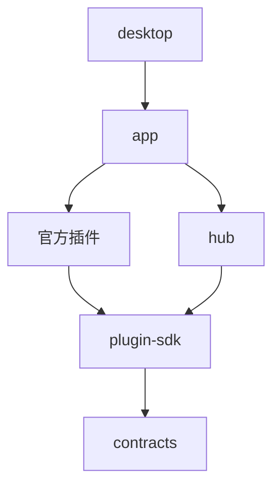

# 代码架构

打开 [交互架构图](architecture.html) 查看 Hub 驱动的插件架构。三个横向区块用于组织阅读：应用入口与呈现、Hub 与功能插件、数据与本机服务。这不是 MVC 的逐层调用关系。

中间只有一个「Hub · 单个运行时」容器，服务路由与事件总线是它内部的两个模块。生命周期与权限管理同样由 Hub 承担。框内的内部模块不是独立插件，也不是两个 Hub 实例。

- **灰色实线**：服务调用，经 Hub 路由到提供方；入口实线另标 HTTP/SSE、MCP 或登记/启停。
- **紫色虚线**：发布方 → Hub → 订阅方；主要示例为 `item.collected` 与 `item.screened`。
- 绿色模块按实际插件边界绘制：screen 与 llm、dispatch 与各渠道都分开。图仅选主要插件和代表性路径；没有连线不表示插件绕过 Hub。
- `store` 是 app 打开并注入 Hub 的存储实现；SQLite 是介质。`secrets` 是受 Hub 管理的官方插件，按数据职责放在下方。

当前图规格为 `hub-operations-v1.json`。结构校验回执见 `architecture.validation.json`，交付哈希见 `architecture.delivery.json`，多尺寸浏览器证据见 `architecture.visual-check.json`。

完整的 18 个插件清单、原图归组与真实代码边界，以及单一职责评估，见 [插件边界核对](plugin-boundaries.md)。本次已把 web 的操作治理拆成 operations 插件；AI 规划归 Agent，界面数据仍归 web 的 workspace-state 服务。

## 主要接口与事件

| 类型 | 路径 | 对应代码 |
| --- | --- | --- |
| 界面接入 | Web 界面 → web：HTTP、SSE | `crates/web/src/lib.rs`、`chat.rs` |
| MCP 接入 | 外部 AI → app stdio 桥 → web 协议适配 → Hub → operations | `crates/app/src/mcp.rs`、`crates/web/src/mcp.rs` |
| 插件组装 | app → Hub：登记、启动、监督插件 | `crates/app/src/lib.rs`、`crates/hub/src/lib.rs` |
| 服务调用 | 插件 → Hub → item-query、screening、llm、agent、dispatch、channel 等服务提供方 | `crates/contracts/src/`、`crates/hub/src/link.rs` |
| 采集事件 | collect 发布 item.collected → Hub → screen 订阅 | `crates/collect/src/`、`crates/screen/src/lib.rs` |
| 分析事件 | screen 发布 item.screened → Hub → dispatch 订阅 | `crates/screen/src/`、`crates/dispatch/src/lib.rs` |
| 数据访问 | Hub 路由 store 服务，按插件表权限访问 SQLite；密钥经 secrets 服务 | `crates/store/src/lib.rs`、`crates/hub/src/link.rs`、`crates/secrets/src/` |

| 层 | 代码位置 | 职责 |
| --- | --- | --- |
| 桌面入口 | `crates/desktop/src/main.rs`、`updates.rs`、`installer/` | Tauri 窗口、托盘、单实例、签名更新、安装退出 |
| 应用组装 | `crates/app/src/lib.rs`、`mcp.rs` | 配置与数据目录、官方插件登记、MCP stdio 桥接 |
| 插件框架 | `crates/hub/`、`plugin-sdk/`、`contracts/`、`auth/` | 生命周期、服务路由、事件、权限、类型契约 |
| 界面接入 | `crates/web/src/`、`templates/`、`assets/` | 信息流、会话与设置交互、MCP协议、确认UI；workspace-state保管界面数据 |
| 应用操作 | `crates/operations/` | app-operations服务：工具目录、计划、有效期、确认执行、防重放；只通过Hub调用目标服务 |
| 采集 | `collect/`、`rss/`、`x-browser/`、`binance-ann/`、`okx-ann/` | 消息入库、RSS、X 浏览器采集、公告 |
| 分析 | `screen/`、`llm/`、`agent/`、`rulebook/` | 初筛、模型服务、消息分析与追问、规则 |
| 推送 | `dispatch/`、`wechat-ilink/`、`wecom-webhook/`、`ilink/` | 发送队列、重试、渠道额度与收发、微信协议 |
| 基础服务 | `store/`、`secrets/`、`scheduler/`、`maintenance/` | SQLite、加密密钥、定时任务、数据维护 |

上述简写目录均位于 `crates/`。各插件通过 `plugin-sdk` 与 `contracts` 使用服务；应用入口负责组装，Hub 负责运行。插件通过 store 服务访问各自数据表。

验证范围与实操结果见 [本轮验证记录](operations-verification.md)。

## Agent 与 LLM 的真实依赖

`agent/plugin.toml` 要求 `llm = "1.1"`，`agent/src/ask.rs` 和 `agent/src/operations.rs` 通过 `LlmClient(ctx.service("llm"))` 调用。图中的 Agent → Hub → llm 实线就是此运行时依赖，Agent 不直接依赖 llm 的 Rust crate。

内部操作路径：web → Hub agent.operate → Hub app-operations 的只读目录/快照 → Hub llm.chat → Hub app-operations.prepare。外部路径：stdio → 本机HTTP协议适配 → Hub app-operations。两者生成同一个 operation_plans 表中的待确认计划；Agent 没有 confirm/cancel 权限。

operations 调用 workspace-state 是可选的能力依赖；web 与 agent 也可选调用 operations。Hub 对可选依赖优先排序，但允许软依赖环；必需依赖环仍禁止。插件未运行时调用返回不可用，界面状态标为同步失败，不能伪装空计划。

## MCP 与更新

外部客户端启动 `desktop.exe mcp`，通过 stdio JSON-RPC 连接本机应用；内部 AI 使用同一套工具目录和执行入口。查询直接返回；修改生成持久化计划，用户在应用确认后，由 operations 经 Hub 调用能力服务执行，不再回调 GUI HTTP 路由，取消、过期或重复确认不能再次执行。密钥在本机确认面板单独输入。

桌面更新从 GitHub Release 的 `latest.json` 获取版本与签名信息，自动检查、用户确认后下载安装。下载文件先校验签名，再停止核心服务并交给 NSIS。签名私钥保存在仓库外，CI 使用 GitHub Secret。

## 构建依赖示意

此依赖图只突出分层关系；具体依赖以各 crate 的 `Cargo.toml` 为准。
