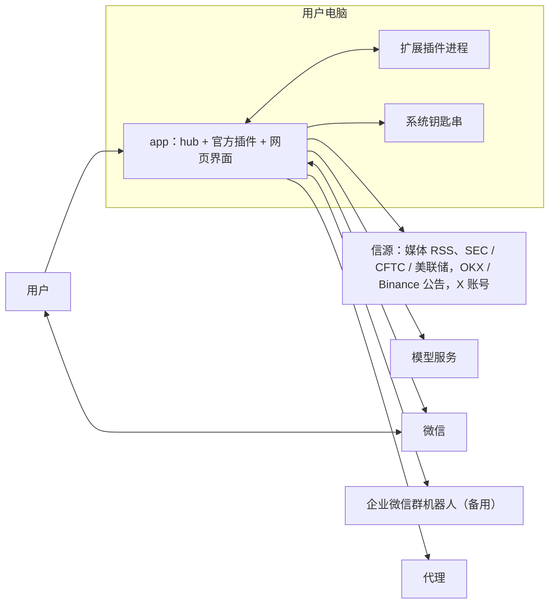
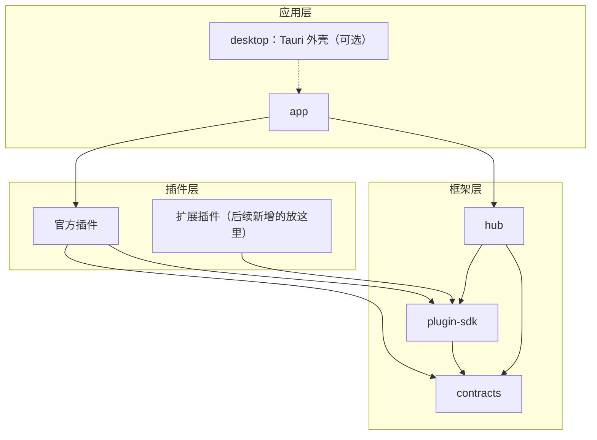
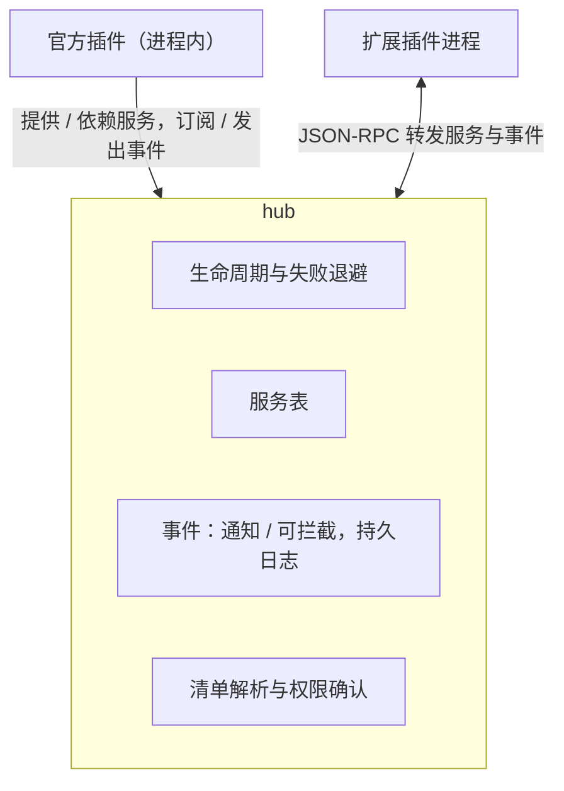
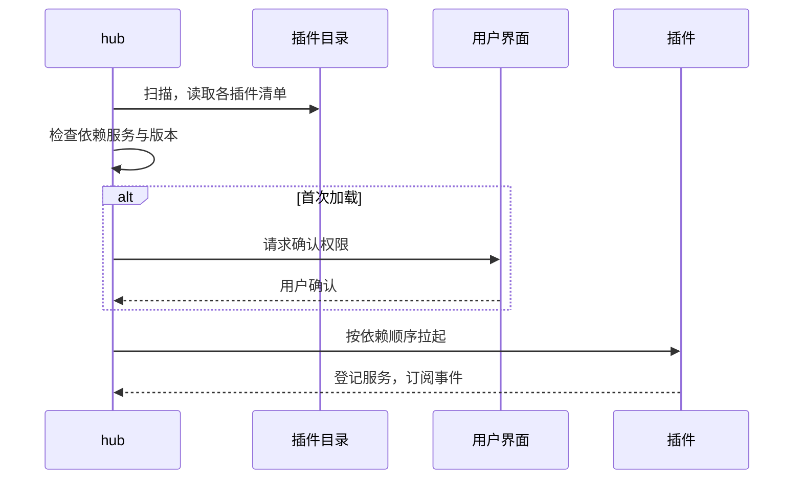
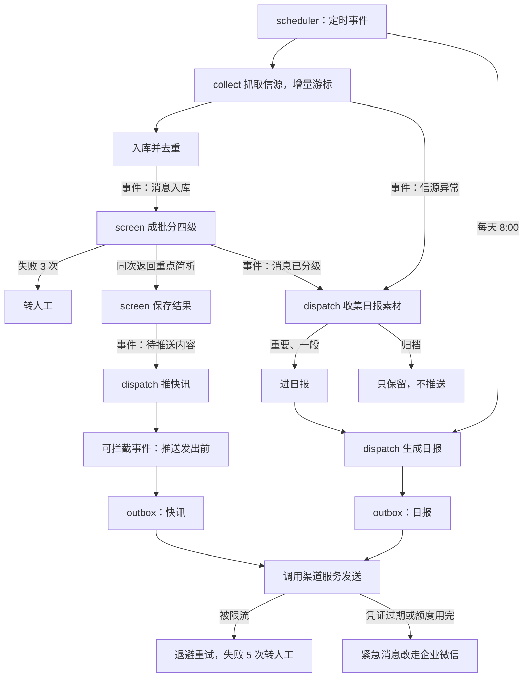

# 消息面分析系统设计文档

最后更新：2026-10-15

个人用的加密货币消息面分析：自动收集一手信源和官媒消息，分级、总结后推送到微信，并支持追问。只做消息面，不做行情计算和价格预测，结论仅供参考。本文只讲架构，细节在开发各任务时再生成。

## 定位与边界

- 单用户，只在用户自己的电脑上运行，界面是本机网页，另有可选的桌面外壳。
- 分析单位是消息，币种、机构等只是标签。
- 电脑休眠或关机时暂停，开机后按增量游标补抓。
- 不实现任何服务器部署功能。

## 整体架构

### 1. 系统上下文

### 2. 分层与依赖

依赖方向只能自上而下；app 不依赖 desktop。

官方服务接口放在 contracts 里，所以官方插件直接依赖 contracts。扩展插件依赖 plugin-sdk，如果需要，也可以依赖其他插件发布的接口 crate。

### 3. hub 与插件

hub 是 Rust 自写的最小化 Cordis 复刻，不做业务。一切皆插件，不分内外：

- 官方插件编译进 app，在进程内运行。
- 扩展插件是插件目录下的单独可执行文件加 `plugin.toml`，重启后加载，不做热重载。
- 两种插件用同一个 plugin-sdk 写。

插件之间的规则：

| 规则 | 说明 |
| --- | --- |
| 事件与服务 | 事件用于通知（通知、可拦截两种），服务用于调用 |
| 依赖 | 依赖的是服务，不是插件；缺必需服务不启动，循环依赖拒绝启动 |
| 数据归属 | 每个插件只读写自己的表，所有数据都经 store 访问 |
| 事件持久 | 先写日志再分发，订阅者各自记位置，至少一次送达，处理要幂等 |
| 追踪 | 每条消息带追踪 ID |
| 失败隔离 | 一个插件失败只影响自己，失败后退避重启；依赖它的插件暂停，恢复后自动恢复 |

#### 最小复刻范围

hub 控制在约两千行，阶段 1 先实现。

| 保留（照 Cordis 的做法） | 舍弃 | 新增（Cordis 没有，我们需要） |
| --- | --- | --- |
| 每个插件有自己的作用域和生命周期 | 用 Proxy 或混入隐式访问服务，改为显式取服务 | 业务事件持久化，每个订阅者有自己的处理位置 |
| 服务的提供与注入：依赖的服务就绪才启动；提供者消失时，依赖它的插件先停下，提供者回来后自动重启 | 插件内嵌套子插件、子上下文 | 单独进程插件经 JSON-RPC 运行 |
| 事件的两种发法：并行通知、按顺序可拦截 | 同一插件多实例（fork）：每个插件只有一个实例，多个信源是插件配置里的多行 | 插件清单里的服务版本约束 |
| 副作用自动收集：插件登记的监听、定时任务、子任务，停止时按相反顺序清理 | 热重载 | 首次加载时确认权限 |
| 插件配置带结构说明，界面据此生成表单 | 上下文过滤与隔离 | 追踪 ID |
| 加载器：Cordis 读配置文件，我们扫描插件目录，再加上配置里的启用开关 | 运行中由别的插件动态加载插件；框架内部的生命周期事件 | 日志脱敏 |

### 4. 新插件如何加载

### 5. MVP 主流程

## MVP 官方插件

| 插件 | 职责（一行） |
| --- | --- |
| store | SQLite；密钥加密存储，主密钥放系统钥匙串 |
| llm | 多模型服务：OpenAI 兼容适配器（默认）和 Anthropic 适配器；服务可增删改、设默认、按用途分配模型、测试连接；两种适配器都是真 SSE 流式输出且可取消 |
| rulebook | 一份规则文本，界面上可编辑；MVP 不做版本和回放 |
| auth | 认证与权限统一入口，首版恒为主人 |
| web | 本机网页界面和 `/api/v1`：主界面（看板、消息列表、右侧流式追问、会话栏），以及五个分区的设置页（模型、信源、推送、插件、网络与系统） |
| scheduler | 发定时事件 |
| collect | 调度信源抓取，增量抓取，入库去重，断流报警；提供"消息检索"服务（`raw_items` 归 collect，其他插件不直接读） |
| screen | 一次批量调用完成分四级与重点简析，失败 3 次转人工；附硬规则和关键词兜底；发"待推送内容"事件；同时输出相关币种和方向（见"效率改版"）；提供按天、信源、币种的统计 |
| dispatch | 订阅"待推送内容"推快讯（以后 merge、debate 也发该事件），经"推送发出前"可拦截事件，免打扰和合并快讯在这一步处理；订阅"消息已分级"收集日报素材，日报用事件里带的数据或调用 collect 的"消息检索"服务；每天 8:00 发日报，按"日期 + 时段"记账，"重要"级放在日报最前面单独一栏，休眠错过的开机补发；开机补抓的消息超过 2 小时的，不推快讯，改进日报并标"补抓"；outbox 负责退避重试和限流，失败 5 次转人工，微信额度不够或凭证过期时紧急消息改走企业微信 |
| agent | 只做追问：只读，调用 collect 的"消息检索"服务加模型回答，附原文链接；渠道追问之外，提供 `agent.ask`（一次性）和 `agent.ask_stream`（流式）服务给界面追问 |
| maintenance | 每天备份，保留 7 份；归档级消息保留 90 天后清理 |
| rss | 信源：加密媒体（CoinDesk、Cointelegraph、Decrypt、The Block、PANews、吴说等）、项目方博客、SEC、CFTC、美联储；订阅清单存在 `feeds` 表，可在设置页增删改和暂停（feed-admin 服务）；默认清单按条目增量播种，新版本新增的默认订阅会补进老用户的清单，用户删掉的内置订阅不再写回 |
| okx-ann、binance-ann | 信源：OKX 公告、Binance 公告 |
| x-browser | 信源：X 账号时间线。用系统里已装的 Chrome、Edge 或 Chromium（按此顺序查找，不下载浏览器），浏览器配置目录放在数据目录下；用户在弹出的浏览器窗口里自己登录 X，程序不接收账号密码；所有请求走配置的代理；找不到浏览器或未登录时停用并在设置页提示。提供 `source` 和 `x-admin` 1.0（状态、登录、关注账号增删和暂停） |
| wechat-ilink | 渠道：微信；自己管理约 24 小时的凭证和约 10 条的额度，日报末尾提示用户回复以续期 |
| wecom-webhook | 渠道：企业微信群机器人（备用） |
| hub、contracts、plugin-sdk | 框架层：插件框架；表结构、事件、服务接口；插件开发接口 |
| app、desktop | 可执行程序；Tauri 桌面外壳 |

## 横切规则

| 项 | 规则 |
| --- | --- |
| 代理 | 官方插件共用一个必须带代理的 HTTP 客户端；扩展插件进程由 hub 注入 HTTP_PROXY 和 HTTPS_PROXY |
| 日志 | 统一脱敏，密钥不进日志 |
| 单实例 | 同时只允许一个 app serve 运行 |
| 时间 | 一律按 UTC 存储 |
| 进程传输层 | 是 trait，首版只有 stdio |
| 主密钥来源 | 是 trait，首版只有系统钥匙串 |
| 监听地址 | 可配置，首版只允许本机 |
| 认证 | 有统一入口，首版恒为主人 |
| 用户 ID | 个人数据带用户 ID |
| 流程与规则 | 分级、推送这些流程写在代码里，判断标准写在规则手册，改标准不用改代码 |
| 推送格式 | 快讯和日报按结构化模板渲染：按 🔴 重要、🟡 关注、🟢 其他分组，每条有标题、影响、原文链接，末尾一行统计。企业微信用 markdown，单条不超过 4000 字节，超出分批；微信不渲染 markdown，用【】标题、分隔线、编号、单独一行的 🔗 链接排版。"影响"由 screen 简析生成，dispatch 只套模板、分批、选通道；改样式不用改分级逻辑 |
| Agent 安全边界 | MVP 只读：不执行命令、读不到密钥明文、外部内容当数据处理 |
| 已定事项 | 新增 digests 表，由 dispatch 写入；"重要"级消息进日报最前面单独一栏；补抓阈值 2 小时 |

## MVP 阶段

| 阶段 | 目标 | 验收 |
| --- | --- | --- |
| 0 实测验证 | 验证关键外部条件，不通则先调整方案 | 每项都有结论 |
| 1 hub 与采集 | hub、plugin-sdk、五个信源稳定入库、断流报警；web 最小页面：插件与信源状态、权限确认；用一个示例扩展插件验证 | 五个信源稳定入库；示例插件放进插件目录、重启即加载 |
| 2 初筛与日报 | screen 分级，dispatch 生成日报 | 朋友认为样例日报可用 |
| 3 推送 | 快讯、微信、企业微信备用通道、追问 | 连续 7 天日报按时送达；凭证过期后紧急消息改走企业微信；追问回答引用来源 |
| 4 桌面外壳 | Tauri 桌面安装包；多模型服务与流式追问；订阅管理；主界面与设置页按原型 v15 复刻；设置与桌面外壳联动（T-040～T-045） | 在朋友电脑上一键安装运行 |

阶段 0 验证项：

| 验证项 | 内容 |
| --- | --- |
| 微信推送 | 主动推送能否送达，凭证和额度行为 |
| 代理 | 代理下各信源可访问 |
| 模型服务 | 国内 OpenAI 兼容服务跑通 |
| 企业微信消息长度 | 实测单条上限（据称 4096 字节，未核实） |
| Binance 公告接口 | 该接口未写入官方文档，要确认能稳定抓取 |

## 效率改版（MVP 之后的第一次迭代）

目标：提高获取信息和做决策的效率。MVP 的界面以插件管理为中心，改版后以消息为中心：一屏看完新消息，筛选后点开一条看详情，直接追问。

| 项 | 内容 |
| --- | --- |
| 首页改为动态消息流 | 正式界面对齐 v17：左侧紧急事件大卡片、重要利空与重要利好两张小卡片，范围为近 7 个本机日历日内已加载消息；下方保留完整时间流并分页加载更早历史。每 30 秒自动同步已采集数据，显示倒计时、手动刷新和结果；信源仍按各自采集周期运行。中间统一消息分析与追问时间线，点击消息加入会话，可逐条移出、撤销，支持最多 20 条参考消息；右侧管理持久化会话。保留筛选、待跟进、人工改级、原文及统计/设置入口。 |
| 统计页 | `/stats` 看近 7 天或 30 天：消息、紧急、重要、未读四个数字；按天堆叠柱状图；币种、信源排行。数据来自 screen 的统计方法。点数字、柱子或横条，跳回动态页并带上对应筛选 |
| 管理页收进设置 | 原来的一级菜单去掉，信源、规则、渠道、推送、日报、密钥、用量和插件页都放在 `/settings` 下，设置页还可编辑关注币种。原首页的插件页移到 `/plugins` |
| 详情与追问 | 每条消息以分析卡片追加到统一会话时间线，后续追问默认参考全部当前卡片，卡片快捷追问仅参考该卡片。显式参考资料通过 agent.ask_stream 传递；历史问答用于理解指代，事实以当前资料为准。移出不删除历史回答和引用，历史问题保留当时的参考消息快照。会话内容、参考资料及卡片相对轮次顺序持久化。 |
| 打开原文 | 由核心调用系统默认浏览器打开，只允许 http 和 https；界面上所有"原文"链接都走这个接口，同时保留普通链接作为退路。打开动作是可替换的实现，测试里不会真的打开浏览器 |

初筛的补充：

- 除级别外，初筛还输出相关币种（大写代码，最多 5 个）和方向（利好、利空、中性）。只写明确涉及的币种，泛指整个市场时留空。
- 硬规则保留最低优先级，模型可升级不可降级。新消息在同次初筛中返回币种、方向、中文标题、摘要、重点证据和影响简析；模型失败时硬规则仍生效，关键词兜底或人工待审保留。历史已完成消息不自动补分析，也不为缺失字段再次付费调用。
- 方向只是对消息性质的判断，不是价格预测，不构成投资建议。

agent 的补充：

- 界面追问走 `agent.ask` 服务，只允许 web 调用；渠道追问保持原行为。
- 本版一次性返回完整回答；阶段 4 已加流式与取消（`agent.ask_stream`，见"阶段 4 实现补充"）。

## 阶段 4 实现补充（T-040～T-045）

| 项 | 内容 |
| --- | --- |
| 多模型服务 | llm 提供 `llm` 1.2：`providers` 表保存多个服务（kind 为 openai 或 anthropic，含接口地址、模型列表、是否默认、最近一次测试结果），`assignments` 表按用途分配服务和模型。选模型：请求带用途且有分配则用分配；否则用默认服务，小档用第一个模型，大档用第二个（没有则第一个）；没有任何服务时报"还没有配置模型服务"。密钥存 secrets，键 `llm.key.<id>`，界面只显示已设置或未设置。第一个保存的服务自动成为默认，默认服务不能删除。旧的单服务配置在 providers 表为空时迁移一次 |
| 流式与取消 | OpenAI 兼容与 Anthropic 原生都用真 SSE 流式。每段文本发 ephemeral 事件 `llm.delta {stream_id, text}`；收到 ephemeral 事件 `llm.cancel {stream_id}` 即停止，返回已生成部分并标 `cancelled`。用量按（日期、模型、用途）记账，失败计入失败次数；不统计金额 |
| 测试连接 | `test` 用服务的第一个模型发一个极短请求，返回成功与否、说明和耗时，结果写回 `providers.last_test` |
| 订阅管理 | rss 提供 `feed-admin` 1.0（列出、保存、删除、暂停/恢复）；`feeds` 表加 `feed_meta` 表（记录默认清单已播种，删除内置订阅后不再播种）。暂停的订阅不出现在 `source.list`。collect 的 `source-status` 升到 1.1，新增 `retry`：清掉该信源的上次尝试时间并立即唤醒调度，不等抓取完成 |
| 推送规则 | dispatch 新增三个布尔配置：`push_urgent`、`push_important`（关闭后对应级别不立即推送，仍进日报）、`digest_enabled`（关闭后不发定时日报，预览仍可用）；免打扰仍是 `quiet_hours` |
| 桌面设置同步 | 设置页通过 hub-admin 的 `app_set` 写 `autostart`、`close_to_tray`；desktop 核心启动后设置运行时 `shell=desktop`，每 2 秒读取这两项并应用到系统自启与托盘勾选，托盘切换自启时反写 `app_set`。`close_to_tray` 为 false 时关窗等同退出。非桌面运行（`shell` 不是 desktop）时这两项在界面禁用 |
| 主界面 | 正式界面对齐 v17：左侧紧急事件大卡片、重要利空与重要利好两张小卡片，范围为近 7 个本机日历日内已加载消息；下方保留完整时间流并分页加载更早历史。每 30 秒自动同步已采集数据，显示倒计时、手动刷新和结果；信源仍按各自采集周期运行。中间统一消息分析与追问时间线，点击消息加入会话，可逐条移出、撤销，支持最多 20 条参考消息；右侧管理持久化会话。保留筛选、待跟进、人工改级、原文及统计/设置入口。 |
| 流式追问 | `POST /api/v1/chat` 存用户消息并生成 stream_id，后台调用 `agent.ask_stream`；前端用 EventSource 连 `GET /api/v1/chat/stream/{id}`，web 订阅 `llm.delta` 按 stream_id 以 SSE 推 `delta`，结束推 `done`（含渲染后的回答和引用）并保存；停止按钮 `POST /api/v1/chat/stream/{id}/cancel` 发布 `llm.cancel`，保存已生成部分。回答里的 `[n]` 渲染为可点上标，点击在左侧定位对应消息 |
| 设置页 | `/settings` 五个分区，左侧导航联动高亮：模型（服务卡片、编辑、测试连接、设默认、删除、用途分配、本月用量）；信源（RSS 订阅增删改、暂停、立即重试，非 RSS 信源只显示状态与重试）；推送（渠道状态、企业微信 Webhook 更换与测试发送、微信绑定、推送规则）；插件（开关、授权、配置表单、重启）；网络与系统（代理或直连、测试连接、开机自启、关窗缩托盘、版本）。旧的 `/plugins`、`/sources` 重定向到 `/settings` 对应分区；规则、消息、发送记录、日报记录等页面保留入口 |

## 信源扩充（T-057～T-060）

| 项 | 内容 |
| --- | --- |
| 媒体 RSS 默认清单 | CoinDesk `https://www.coindesk.com/arc/outboundfeeds/rss`；Cointelegraph `https://cointelegraph.com/rss`；Decrypt `https://decrypt.co/feed`；The Block `https://www.theblock.co/rss.xml`；PANews `https://www.panewslab.com/rss.xml`；吴说 `https://www.wublock123.com/feed`；Bitcoin Magazine `https://www.bitcoinmagazine.com/.rss/full/`；Ethereum 博客 `https://blog.ethereum.org/feed.xml` |
| 增量播种 | `feed_meta` 记录已播种过的内置订阅 ID |
| SEC 联系邮箱 | SEC 要求 User-Agent 带联系邮箱：rss 配置项 `contact_email` 为空时，SEC 订阅不请求，信源状态显示"需要在插件配置里填联系邮箱" |
| x-browser | 表 `x_accounts`（handle、paused、builtin、created_at）、`x_seen`（可选，用于去重游标）；信源 ID `x:<handle>`；默认关注 VitalikButerin、cz_binance、brian_armstrong、saylor、haydenzadams、binance、okx、coinbase、SECGov；抓取间隔默认 10 分钟，账号之间串行并间隔几秒；页面结构变化或抓取失败时报信源失败，不崩溃；登录态失效时 `x-admin.status` 的 `logged_in` 为 false，设置页提示重新登录 |
| 设置页 X 卡片 | 设置页信源分区的 X 卡片改成可用：状态（浏览器、是否登录）、"登录 X"按钮、关注账号的增删和暂停 |
| 历史补分析 | 已关闭；保留已有结果，缺失字段不自动追补 |

## 后续扩展

- merge 事件合并
- debate 多 Agent 讨论
- 对话 Agent 与工具调用：三档确认，挂在"工具执行前"可拦截事件上
- 对话管理与会话日志
- 跨信源同一事件合并
- 插件日志查看、卸载、在设置页安装扩展插件（目前只提示把插件放进插件目录后重启）
- 规则版本与回放预览
- 更多信源（GitHub 发布、X 列表页采集）
- Telegram 等渠道
- 对外 HTTP API
- MCP 转接插件
- 插件自带页面
- 多用户
- 服务器部署与远程采集

## 当前交互补充：分栏与跨端会话

左右分栏可拖拽调整（消息流占比 28%–72%），支持键盘左右方向键、Home/End 及双击恢复默认。比例与追问区收起状态保存在本机浏览器，收起后消息流占满可用宽度；点击消息或主动选择会话时展开。自动刷新和后台消息同步不会擅自展开。

微信问答与桌面续问以 agent 持有的共享会话记录为准，web 保存显示所需的投影。会话按渠道、外部用户、conversation 三元组隔离。桌面续问写入持久化待同步记录，失败后后台重试；唯一消息键保证重试不重复入库。记录每条提问的来源，界面每 5 秒检查更新并提示新消息。两端后续追问携带同一会话最近 5 轮历史；微信续问还会优先读取上一轮引用或指定的参考资料，历史只用于理解指代，事实仍以本次检索资料为准。

桌面续问不会主动另发微信消息。同步从此版本启用后开始，旧版只保存了回复去重标记，无法恢复未保存的旧微信正文。

## 首页与重点事件（0.1.3）

以 docs/prototypes/feed-first-v17.html 当前修订为交互基准。首页合并消息与对话，不再显示统计入口；信源状态在消息标题旁。筛选采用多选浮层，关键词支持空格 AND、英文引号短语和减号排除，说明收进问号。

事件按模型提取的具体事件标识聚合（标识须包含事件日期、对象、行动、产品/金额/统计周期）；缺失元数据的旧消息按同日相同标题保守归并。当前聚合范围为已加载报道，历史分页会增加证据。初筛核实信息不是独立外部核验；官方确认还要求原始官方域名与具体依据，多源报道不等于独立证实。历史已完成消息不自动补分析，也不补推。

重点区不折叠：自然高度受首屏预算限制，超出后分类内部滚动，底部“还有消息 ↓”在到底后消失。紧急6小时、重要且有明确方向24小时，按原始发布时间计算；缺失时间不进入速览/推送。风险升级、实质进展、常规事件依次排序，同级按最新报道。

推送设置由 dispatch SQLite 持久化，与首页临时条件独立。紧急立即入队，重要5/10/15分钟合并；持久化事件修订去重，重复报道不推；实质更新可再推。保存设置取消旧待发重点，新发布消息才进入队列。发送/重试再次核查时效和范围；重点模式停用旧的自动日报，系统异常提醒保留。focus_mode=false 仅供明确选择的旧版兼容模式，不是默认。

## 0.1.4 安装版验收修正

搜索输入框与筛选入口保留为稳定DOM节点，输入、中文组合输入、筛选切换只更新结果区，避免快速连续输入丢字、引号重复及多选浮层随入口重建而关闭。筛选重绘后恢复同项焦点。重点分类高度根据原生WebView实际尺寸及标题高度分配，保留完整首条标题的阅读空间；重点卡片摘要收敛，完整依据与分析仍在详情中。

安装版原生验收同时修正：聚合事件引用显示每条原始报道标题，成员报道不会误标为“已移出”；设置页跳回首页需等消息加载后再打开推送预览；事件流连续加载按事件数判断，避免聚合后报道数和事件数不一致造成分页停滞。

### 0.1.5 安装版反馈修正

- 首页不再显示单一“首页”标签；消息流与会话默认宽度 2:1，双击分隔线恢复该比例。布局存储版本更新一次，之后仍保存用户手动调整。
- 企业微信群机器人设置接受完整官方 Webhook 地址或单独 key，发送时只取 query 中的 key，修复完整链接被当 key 二次拼接的问题；既有配置无需重新复制。
- 企业微信凭证错误显示“链接无效”，不再误称定时过期；40035 参数错误不再归类为凭证过期。微信会话过期提示不受影响。

### 0.1.6 模型消耗控制

- 取消历史自动补分析与升级触发重分析，不更改已有分级。
- 初筛 JSON 同时返回 impact，取消逐条 analyze 请求。紧急/重要硬规则进入同批补齐，模型失败仍保留级别，模型可升级不可降级。
- 同信源、同 UTC 发布日、URL 来源、完整标题/摘要和规则手册一致才复用结果；保留全部报道。摘要缺失、不同信源、标题/摘要/日期/规则变化都独立判断，防止漏掉官方确认、风险升级与新增事实。只复用新版本建立的缓存，不扫描旧消息。
- 每批最多 10 条，输出预算 max(2048, 256 + 实际独立条数 × 768) token（最多 7936）；不截短现有初筛输入，不减少重点分类与核实证据字段。缺条继续采用既有退避重试上限。

### 0.1.7 状态同步职责

状态归属：微信插件维护收消息时间、额度和会话；信源服务维护采集健康；主程序 Hub 管理插件生命周期。web/status.rs 只协调现有本地状态接口，返回 /api/v1/status 分区快照，短缓存合并并发读取，不持久化业务状态或统一历史。接口校验 web.view 与 channels.read，插件快照只包含运行状态，不返回配置。

前端 app-status.js 提供 get/subscribe/unsubscribe/sync，统一每 2 秒读取、单请求在途；页面后台暂停，回到前台与手动刷新立即同步。各分区独立标记 stale，失败保留最后数据并明确标记，避免把旧值当当前状态。首页微信额度、最近收消息时间、推送窗口及告警，设置页渠道、信源和插件徽标使用这一入口；新插件通过 Hub 的生命周期状态自动纳入。新增专有业务指标需要从插件自己的状态接口增加适配，不在 UI 编造状态。

微信额度为应用依据收消息与发送结果记录的本地会话额度，并非服务端余额查询；发送仍以服务端返回为准。恢复后积压提醒、日报与追问回复可能继续消耗，本次不自动清空用户待发队列、不改变补发策略。

### 0.1.8 微信推送仅限紧急事件

渠道恢复只唤醒微信重点快讯与用户明确请求，不唤醒系统提醒和日报。旧微信待发日报标记 dropped，系统提醒标记 manual，保留记录与原因。自动发送前逐条验证初始级别和当前级别都为紧急，并复查6小时时效、推送范围和重复事件；重要利空/利好不通过微信自动发送。不增加条数限制、冷却时间或互动额度保留线，底层协议限制仍由微信渠道处理。其他渠道沿用用户推送设置。用户主动点击测试或手动重试以 user_requested 标记区分，直接追问回复保持原行为。

### 0.1.9 推送队列数量

推送设置展示全队列与各渠道剩余待发通知、当前到期待发送、延后重试、待人工处理数量；focus_pending 中未合并成通知的事件单独计数，避免混淆事件与发送批次。dispatch.queue_summary 通过全量 SQL 聚合统计，不受 outbox 列表分页影响，已发送/丢弃不计入剩余。统一状态模块新增 queue 分区，沿用2秒同步和过期数据标记；停用时显示不可读取，绝不把不可用冒充0。队列计数遵循 outbox.read 权限，缓存响应也按当前权限遮蔽。

### 0.1.10 渠道额度与队列可视化

微信卡片使用原生 progress 展示剩余额度 / 会话恢复额度（channel.info 的可选 quota_limit，由微信插件实际配置提供），低余额变色；最近收消息与窗口时间按两列次要信息展示。各渠道以突出数字显示待发队列，辅以延后/人工数量。未知或停用显示破折号和原因，同步失败标记旧数据，不伪装成0或满进度。企业微信以每分钟20条为容量，进度条展示本应用最近60秒成功发送后的估算剩余额度：成功一条扣一条，失败不扣，每条满60秒自动恢复。统计由企业微信插件维护，经统一状态入口每2秒更新；不改变既有发送间隔和推送范围。此为本地估算，不含其他客户端发送，插件重启后重新统计，实际发送以企业微信返回为准；规则细节放在说明提示中。

### 0.1.11 推送测试停用提示与数字对齐

发送测试仍通过dispatch队列，不绕过调度直接发渠道。调度不可用时返回可嵌入页面的明确失败提示，说明未入队及上方调度开关恢复方法。发送队列标题旁展示推送调度开关，微信和企业微信卡片标题旁展示各自渠道开关，停用后卡片仍可见并可就地开启。开关使用现有Hub启停能力及权限校验，通过统一状态模块实时更新，专用写入口仅允许这三个推送插件，切换后清除状态快照缓存。额度及队列标题行使用baseline对齐，使文字、数字与单位共用基线，不调整卡片底部布局。

### 0.1.12 信源统计说明与 X 账号管理

首页及设置信源区域使用统一状态模块的同一份source-status快照。统计按订阅/公告及每个X账号分别计数，首页注明X账号数量，设置显示两组正常/总数；X登录状态与逐账号采集状态分开展示，不把一张X管理面板当成一个信源。X账号管理面板独占一行，顶部提供采集开关、登录、搜索和添加；账号以响应式多列行展示，采集状态、暂停/恢复和确认删除各自明确。超过186px的账号列表内部滚动，搜索词在状态刷新和片段更新后保留，空列表/无搜索结果分别提示。其他信源卡片按内容高度显示，不被X面板拉伸。

### 0.2.1 设置、MCP 与签名更新

用户已批准原型并要求同步实际应用。最新原型仍为 docs/prototypes/feed-first-v17.html，配套 settings-review.css/js。实际设置页提供信源、关注币种、网络、系统、AI与MCP独立入口。关注币种展示已关注列表、移除、添加、未保存状态、撤销和保存；配色采用低饱和灰绿。X账号支持搜索、增加、暂停/恢复和确认删除，账号超高内部滚动；打开X复用采集资料目录，浏览窗口关闭后恢复后台采集。

应用提供统一MCP工具目录，内部已配置AI与外部stdio客户端共用。查询直接返回，变更生成持久化计划，用户在应用确认后通过既有业务处理器执行；取消、过期、重复确认不能执行。密钥只在本机确认面板输入。自动更新使用Tauri updater与GitHub Release，自动检查，用户确认安装，签名校验后启动安装器。旧版覆盖安装先正常退出，超时只结束目标安装目录下的进程。

公开仓库为panda-student/crypto-news，源码与发行文件分别由Git与GitHub Releases托管。采用Apache License 2.0，第三方组件保留原许可；签名私钥与运行数据不纳入源码。代码分层图见docs/architecture/architecture.html。
